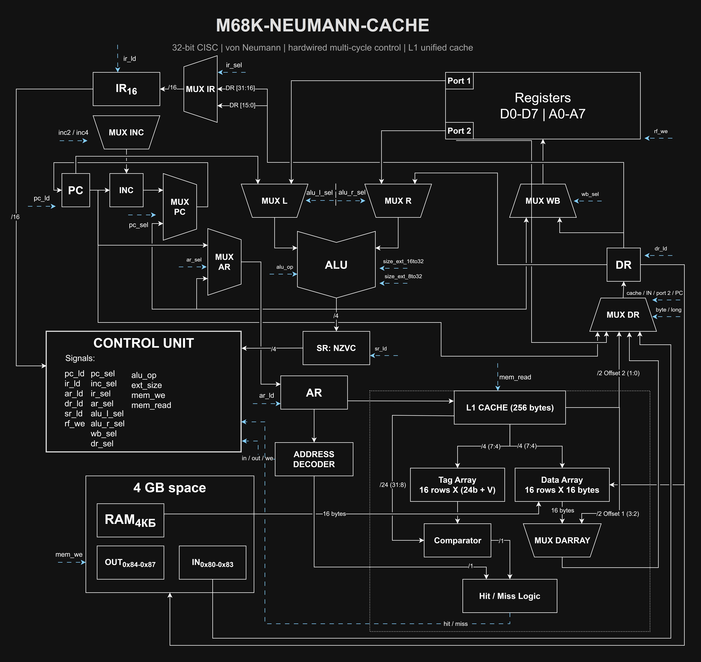

# m68k-neumann-cache

> [code](m68k-neumann-cache.drawio) | [dark png](m68k-neumann-cache-dark.png)
> 

> [!note]
> Поскольку адрес -- 32-битный, то адресное пространство может быть увеличено вплоть до 4 ГБ

> [!important]
> Объём кэша был взят как 1/16 всего объёма памяти, т.е. 4 КБ / 16 = 256 байт. У меня реализован *Direct Mapping*.
>
> Так же важно отметить, что в блоке *Address Decoder* должна быть проверка:
> - что адрес - не `0x80-0x83`, т.к. это порт ввода и он обновляется не нами
> - что адрес - не `0x84-0x87`, т.к. это порт вывода и при записи в него мы подаём импульс, вызывающий отправку на внешнее устройство (скорее всего, верим, что работа с ВУ асинхронная)
