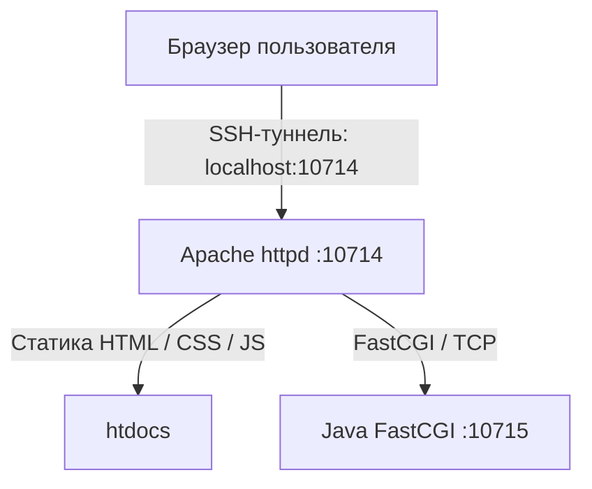
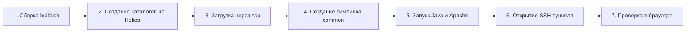

# Развёртывание FastCGI и Apache на Helios

Руководство по сборке, установке и запуску лабораторной работы №2 на сервере Helios кафедры ВТ.

В этой лабораторной веб-сервер делится на две части: Apache httpd обслуживает статические файлы, а сервер Java FastCGI обрабатывает запросы проверки точек и историю.

> [!note]
> В методических материалах по умолчанию упоминаются порты 24000 и 24001. Так как они часто заняты другими студентами, используются свободные порты: 10714 (HTTP для Apache) и 10715 (TCP для Java FastCGI).

> [!important]
> В командах указан логин `s365809` (ИСУ 365809). При использовании другим студентом замените его на свой в командах и в файле `src/httpd.conf`. В коде страницы-перехода в `src/redirect/index.html` используется плейсхолдер `sXXXXXX`, его в исходниках менять не требуется.

## Архитектура развёртывания



## Структура каталогов на сервере Helios

Структура домашней директории пользователя на Helios:

```text
~
├── public_html/
│   └── web/
│       ├── common/                       # Общие ресурсы (стили, шрифты, иконки, JS-модули)
│       │   ├── assets/
│       │   ├── css/
│       │   └── js/
│       │       ├── graph.js
│       │       └── validate.js
│       ├── lab1/
│       └── lab2/                         # Страница-переход
│           ├── index.html
│           └── js/
│               └── copy.js
│
└── httpd-root/                           # Корень личного Apache и FastCGI-сервера
    ├── conf/
    │   └── httpd.conf                    # Конфигурация Apache
    ├── htdocs/                           # Папка статики для Apache
    │   ├── index.html
    │   ├── js/
    │   │   ├── api.js
    │   │   ├── main.js
    │   │   ├── results.js
    │   │   └── toasts.js
    │   └── common -> ~/public_html/web/common/
    ├── fcgi-bin/
    │   └── lab2-server.jar               # Исполняемый jar FastCGI-сервера
    ├── mutex-dir/                        # Системный каталог Apache для блокировок
    ├── error.log
    ├── access.log
    └── fcgi.log
```

Общие ресурсы хранятся в `~/public_html/web/common/`:
- страница-переход обращается к ним по относительному пути `../common/`
- основное приложение обращается к ним через символическую ссылку `~/httpd-root/htdocs/common` по пути `/common/`

## Сборка локально

Сборка запускается из корня репозитория (`ITMO`), требуется JDK 17 или новее:

```bash
# Собрать файлы для личного Apache
bash 3_Web/lab2/src/build.sh

# Собрать страницу-переход в отдельную директорию
bash 3_Web/lab2/src/build.sh redirect

# Очистить результаты сборок
bash 3_Web/lab2/src/build.sh clean
```

Состав локальных сборочных каталогов после запуска команд:

```text
src/build/                                # Каталог для копирования в ~/httpd-root/
├── conf/
│   └── httpd.conf
├── fcgi-bin/
│   └── lab2-server.jar
└── htdocs/
    ├── index.html
    └── js/
        ├── api.js
        ├── main.js
        ├── results.js
        └── toasts.js

src/redirect/build/                       # Каталог для копирования в ~/public_html/web/lab2/
├── index.html
└── js/
    └── copy.js
```

> [!note]
> При компиляции используется ключ `--release 17`, так как на сервере Helios установлен OpenJDK 17.

## Остановка запущенных процессов

Если сервисы уже запущены на сервере (например, перед обновлением jar или конфигурации), остановите их в сессии SSH:

```bash
httpd -f ~/httpd-root/conf/httpd.conf -k stop
pkill -f lab2-server.jar
```

## Пошаговое развёртывание



### 1. Подготовка и загрузка файлов с локальной машины

Команды выполняются из корня репозитория:

1. Соберите обе раскладки:
   ```bash
   bash 3_Web/lab2/src/build.sh
   bash 3_Web/lab2/src/build.sh redirect
   ```

2. Создайте целевые каталоги на Helios:
   ```bash
   ssh -p 2222 s365809@helios.cs.ifmo.ru 'mkdir -p ~/httpd-root/mutex-dir ~/public_html/web/common ~/public_html/web/lab2'
   ```

   > [!warning]
   > Утилита `scp` не создаёт родительские каталоги автоматически при копировании содержимого папок. Обязательно выполните создание папок перед копированием.

3. Скопируйте общие ресурсы в публичный каталог:
   ```bash
   scp -P 2222 -r 3_Web/common/. s365809@helios.cs.ifmo.ru:public_html/web/common/
   ```

4. Скопируйте файлы приложения в `~/httpd-root/`:
   ```bash
   scp -P 2222 -r 3_Web/lab2/src/build/. s365809@helios.cs.ifmo.ru:httpd-root/
   ```

5. Скопируйте страницу-переход в публичный каталог лабораторной:
   ```bash
   scp -P 2222 -r 3_Web/lab2/src/redirect/build/. s365809@helios.cs.ifmo.ru:public_html/web/lab2/
   ```

### 2. Настройка и запуск на Helios

Подключитесь к серверу по SSH:

```bash
ssh -p 2222 s365809@helios.cs.ifmo.ru
```

Внутри SSH-сессии выполните следующие действия:

1. Настройте символическую ссылку на общую директорию:
   ```bash
   rm -rf ~/httpd-root/htdocs/common
   ln -s ~/public_html/web/common ~/httpd-root/htdocs/common
   ```

2. Запустите Java FastCGI-сервер:
   ```bash
   nohup java -Xmx256m -DFCGI_PORT=10715 -jar ~/httpd-root/fcgi-bin/lab2-server.jar \
     > ~/httpd-root/fcgi.log 2>&1 &
   ```

   Параметр `-Xmx256m` необходим, чтобы JVM не пыталась зарезервировать память исходя из всего объёма сервера (что приводит к ошибке `Could not reserve enough space for object heap`).

3. Убедитесь, что процесс слушает порт:
   ```bash
   sleep 2 && cat ~/httpd-root/fcgi.log
   sockstat -4l | grep 10715
   ```

   В выводе лога должна появиться строка `FastCGI стартует, порт 10715`.

4. Проверьте конфигурацию и запустите Apache:
   ```bash
   httpd -f ~/httpd-root/conf/httpd.conf -t
   httpd -f ~/httpd-root/conf/httpd.conf -k start
   ```

   Если команда `httpd` не найдена в системном пути, используйте полный путь `/usr/local/sbin/httpd`. Сообщения вида `Failed to enable the 'httpready' Accept Filter` являются информационными предупреждениями FreeBSD и не влияют на работу сервера.

### 3. Подключение и проверка

1. На локальном компьютере откройте SSH-туннель:
   ```bash
   ssh -p 2222 -L 10714:localhost:10714 s365809@helios.cs.ifmo.ru
   ```

2. Откройте в браузере страницу приложения: http://localhost:10714/

3. Проверьте контрольные сценарии:
   - отображение страницы: интерфейс загружается со стилями, шрифтами и графиком
   - отправка формы: клик по кнопке «Проверить» добавляет точку на график и строку в таблицу
   - клик по графику: клик мышью по холсту определяет координаты, отправляет запрос и отрисовывает точку
   - проверка API через браузер или curl:
     - прямой запрос точки: `http://localhost:10714/fcgi-bin/lab2-server.jar?x=-2&y=2&r=5`
     - запрос накопленной истории: `http://localhost:10714/fcgi-bin/lab2-server.jar?history`
