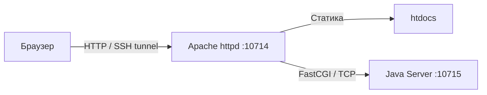
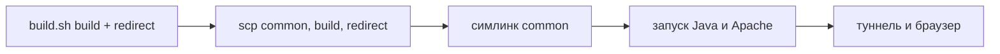

# Лабораторная работа №2 или муки деплоя FastCGI на Helios

В этой работе веб-сервер делится на две части: Apache httpd обслуживает статику, а Java FastCGI-сервер обрабатывает AJAX-запросы `fetch`.

Ниже приведён гайд по тому, как выполнить деплой на Helios. В командах указан полный адрес и порт сервера. Если SSH-ключ ещё не установлен, `ssh` и `scp` будут спрашивать пароль при каждом подключении; настройка ключа описана в заметке [helios.md](../../helios.md).

> [!note]
> Порт в документации с LMS везде -- 24000 / 24001. Поскольку этот порт с высокой долей вероятности будет занят, придумайте свой от 1024 до 65535. Данная работа сделана через порт 10714 / 10715.

> [!important]
> В командах и ссылках ниже используется мой ИСУ: 365809. Замените его на свой в командах и ссылках, а перед сборкой -- также в `src/httpd.conf`. На странице-переходе вместо логина стоит placeholder `xxxxxx`, его менять в исходниках не нужно.

## Архитектура решения

- Apache httpd слушает HTTP-порт и отдаёт HTML, JavaScript и пр.
- Динамические запросы к `/fcgi-bin/lab2-server.jar` перенаправляются модулем `mod_fastcgi` на отдельный TCP-порт FastCGI-сервера.
- FastCGI-сервер -- консольное приложение на Java, принимающее запросы через библиотеку `fastcgi-lib.jar`.



## Структура файлов в репозитории

```text
3_Web/lab2/
├── README.md             # Руководство по сборке и деплою
├── LMS.md                # Текст задания из системы
├── src/
│   ├── httpd.conf        # Конфигурация личного Apache
│   ├── build.sh          # Скрипт сборки
│   ├── index.html        # Страница лабораторной работы
│   ├── js/               # Клиентские модули
│   ├── redirect/         # Страница-переход, js/ и build/ (в git не попадает)
│   ├── server/           # Java-исходники FastCGI-сервера и библиотека
│   └── build/            # Основная раскладка для Helios (в git не попадает)
```

## Структура каталогов на Helios

Структура на Helios после настройки:

```text
~
├── public_html/                          # Публичный каталог (системный Apache кафедры)
│   └── web/
│       ├── common/                       # Общие стили, шрифты и картинки
│       ├── lab1/                         # Файлы первой лабораторной работы
│       └── lab2/
│           ├── index.html                # Страница-переход на туннель
│           └── js/
│               └── copy.js               # Кнопка копирования команды
│
└── httpd-root/                           # Корень личного Apache и FastCGI бэкенда
    ├── conf/
    │   └── httpd.conf                    # Конфигурация Apache
    ├── htdocs/
    │   ├── index.html
    │   ├── js/
    │   └── common -> ~/public_html/web/common/
    ├── fcgi-bin/
    │   └── lab2-server.jar               # FastCGI-сервер
    ├── mutex-dir/                        # Служебный каталог Apache
    ├── error.log
    ├── access.log
    └── fcgi.log                          # Вывод Java-процесса
```

Общие ресурсы лежат в `~/public_html/web/common/`. Страница-переход использует их по относительному пути `../common/`, а основная лабораторная -- через символическую ссылку `~/httpd-root/htdocs/common` и путь `/common/`.

## Сборка

Из корня репозитория (`ITMO`), нужен JDK 17 или новее:

```bash
bash 3_Web/lab2/src/build.sh            # собрать раскладку для личного Apache
bash 3_Web/lab2/src/build.sh redirect   # скопировать страницу-переход в отдельную сборку
bash 3_Web/lab2/src/build.sh clean      # удалить обе сборки
```

Скрипт только собирает файлы: на сервер они попадают отдельными `scp` (см. «Запуск»)

Режим `build` очищает и собирает `src/build/` -- точное содержимое для `~/httpd-root/`:
- `src/index.html` и `src/js/` копируются в `src/build/htdocs/`
- `httpd.conf` -- в `src/build/conf/`
- FastCGI-сервер компилируется в `src/build/fcgi-bin/lab2-server.jar`
- общая папка `3_Web/common/` в сборку не копируется

Режим `redirect` копирует страницу и её `js/` из `src/redirect/` в `src/redirect/build/`. Общую папку он не копирует: страница использует `../common/`

`build` очищает предыдущие сборки, поэтому если нужны обе раскладки, запускайте сначала `build`, затем `redirect`. `clean` удаляет `src/build/` и `src/redirect/build/`

```text
src/build/
├── conf/
│   └── httpd.conf
├── fcgi-bin/
│   └── lab2-server.jar
└── htdocs/
    ├── index.html
    └── js/

src/redirect/build/       # после build.sh redirect
├── index.html
└── js/
    └── copy.js
```

Исходники в `src/` при сборке не меняются. `src/build/` повторяет раскладку `~/httpd-root/`, а `src/redirect/build/` предназначен для отдельной заливки в `~/public_html/web/lab2/`

При сборке через WSL Bash установите JDK внутрь Ubuntu один раз:
```bash
sudo apt update && sudo apt install -y openjdk-17-jdk
```

Компиляция идёт с `--release 17`, потому что на Helios установлен OpenJDK 17. В `src/build/` после сборки остаётся только готовая для копирования раскладка

На Windows запущенный FastCGI-процесс блокирует jar-файл, поэтому перед повторной сборкой его нужно остановить

## Остановка

Если серверы уже запущены на Helios (например, перед обновлением конфигурации или кода), остановите их внутри SSH-сессии:

```bash
httpd -f ~/httpd-root/conf/httpd.conf -k stop
pkill -f lab2-server.jar
```

## Запуск

> [!note]
> Для Apache выбран порт `10714`, а для Java FastCGI -- `10715`. Напрямую из внешнего интернета порты Helios закрыты брандмауэром университета, поэтому браузер подключается через SSH-туннель на `localhost:10714`.



### Локально (из корня репозитория `ITMO`)

1. Соберите обе раскладки -- сначала основную, потом страницу-переход:
   ```bash
   bash 3_Web/lab2/src/build.sh
   bash 3_Web/lab2/src/build.sh redirect
   ```

2. Создайте каталоги на Helios. `build.sh` создаёт только локальные каталоги сборки; удалённые каталоги создаёт эта команда, её можно повторять:
   ```bash
   ssh -p 2222 s365809@helios.cs.ifmo.ru 'mkdir -p ~/httpd-root/mutex-dir ~/public_html/web/common ~/public_html/web/lab2'
   ```

   > [!warning]
   > `scp` не создаёт каталоги назначения. Перед первой заливкой обязательно выполните команду выше: она создаёт `~/httpd-root` с `mutex-dir` и каталоги в `~/public_html/web/`

3. Залейте `common/` в публичный каталог. Повторяйте этот шаг при изменении общих ресурсов:
   ```bash
   scp -P 2222 -r 3_Web/common/. s365809@helios.cs.ifmo.ru:public_html/web/common/
   ```

4. Залейте содержимое основной раскладки в `~/httpd-root/`:
   ```bash
   scp -P 2222 -r 3_Web/lab2/src/build/. s365809@helios.cs.ifmo.ru:httpd-root/
   ```

5. Залейте всю страницу-переход в отдельный каталог:
   ```bash
   scp -P 2222 -r 3_Web/lab2/src/redirect/build/. s365809@helios.cs.ifmo.ru:public_html/web/lab2/
   ```

### Helios

6. Подключитесь по SSH:
   ```bash
   ssh -p 2222 s365809@helios.cs.ifmo.ru
   ```

7. Создайте ссылку на общую папку. Команда безопасна и при повторном запуске: она удаляет только прежнюю ссылку или копию внутри `htdocs`, не исходную папку `public_html/web/common`:
   ```bash
   rm -rf ~/httpd-root/htdocs/common
   ln -s ~/public_html/web/common ~/httpd-root/htdocs/common
   ```

8. Запустите FastCGI и Apache:
   ```bash
   nohup java -Xmx256m -DFCGI_PORT=10715 -jar ~/httpd-root/fcgi-bin/lab2-server.jar \
     > ~/httpd-root/fcgi.log 2>&1 &
   sleep 2 && cat ~/httpd-root/fcgi.log
   sockstat -4l | grep 10715
   httpd -f ~/httpd-root/conf/httpd.conf -t
   httpd -f ~/httpd-root/conf/httpd.conf -k start
   ```

   В `fcgi.log` ожидается `FastCGI стартует, порт 10715`. Флаг `-Xmx256m` обязателен: без него JVM на Helios пытается зарезервировать под кучу десятки гигабайт по объёму памяти хоста и падает с `Could not reserve enough space for ... object heap`

   Если `httpd: command not found`, используйте полный путь `/usr/local/sbin/httpd`. Предупреждения `Failed to enable the 'httpready' Accept Filter` при старте Apache безвредны

9. На локальном компьютере откройте SSH-туннель:
   ```bash
   ssh -p 2222 -L 10714:localhost:10714 s365809@helios.cs.ifmo.ru
   ```

10. Откройте `http://localhost:10714/` в браузере

## Проверка работы

После открытия страницы через SSH-туннель проверьте:
- статика: `http://localhost:10714/` отображает HTML-страницу со стилями и графиком
- динамика: прямой запрос `http://localhost:10714/fcgi-bin/lab2-server.jar?x=-2&y=2&r=5` возвращает корректный JSON-ответ
- история: `http://localhost:10714/fcgi-bin/lab2-server.jar?history` возвращает все проверки, накопленные с момента запуска процесса -- её же страница запрашивает при каждой загрузке

## Редирект

Страница `https://se.ifmo.ru/~s365809/web/lab2/` лежит в `~/public_html/web/lab2/` и использует общие стили из соседней `~/public_html/web/common/`. Она объясняет, что это лабораторная №2 и что на Helios запускается личный Apache httpd с Java FastCGI, показывает команду SSH-туннеля с placeholder `XXXXXX` вместо логина и ведёт на `http://localhost:10714/`.

Режим `redirect` собирает страницу в `src/redirect/build/`; её содержимое заливается отдельно от основной раскладки:

```bash
bash 3_Web/lab2/src/build.sh redirect
scp -P 2222 -r 3_Web/lab2/src/redirect/build/. s365809@helios.cs.ifmo.ru:public_html/web/lab2/
```

Редирект собирается и заливается отдельно от основной раскладки. `common/` в него не копируется

## Локальный просмотр

Для основной страницы используйте статический сервер из `3_Web`, чтобы абсолютный путь `/common/` находил `3_Web/common/`:

```bash
npx serve 3_Web
```

Лабораторная откроется по `/lab2/src/`. Страница-переход рассчитана на размещение в `public_html/web/lab2/`, где `../common/` ведёт в `public_html/web/common/`; для проверки её оформления откройте опубликованную страницу `https://se.ifmo.ru/~s365809/web/lab2/`

Локально проверяются вёрстка, график и уведомления, но не запрос к FastCGI: без бэкенда кнопка «Проверить» вернёт ошибку. Полный сценарий проверяется через SSH-туннель.
