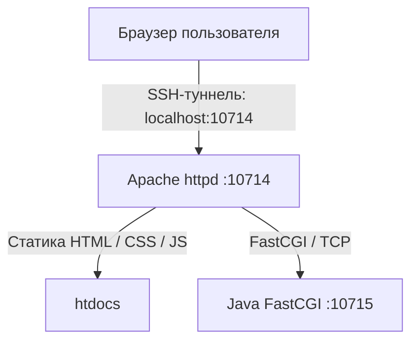

# Лабораторная работа №2 | Веб-программирование

- Студент: Пугин Сергей Евгеньевич
- Группа: P3219
- Вариант: 8679
- Страница-переход на Helios: https://se.ifmo.ru/~s365809/web/lab2/

## О проекте

Веб-приложение состоит из двух компонентов: Apache httpd отдаёт клиентскую статику, а Java FastCGI-сервер принимает AJAX-запросы `fetch`, проверяет попадание точки в заданную графическую область варианта 8679 и сохраняет историю проверок в оперативной памяти.

Так как серверные порты Helios закрыты снаружи межсетевым экраном, основное приложение открывается локально через SSH-туннель на `http://localhost:10714/`. По публичной ссылке на кафедре размещена страница-переход с кнопкой копирования команды туннеля.

> [!note]
> Страница-переход по адресу https://se.ifmo.ru/~s365809/web/lab2/ состоит только из статических файлов в `public_html` и не зависит от личного Apache или Java-сервера, поэтому доступна постоянно. Основное приложение работает только пока на Helios запущены личный Apache и Java FastCGI-сервер, а на локальном компьютере открыт SSH-туннель. Helios не гарантирует постоянную работу пользовательских процессов и портов, поэтому после их остановки сервисы нужно запустить заново по инструкции из [DEPLOY.md](DEPLOY.md).

Подробное руководство по сборке, остановке и запуску сервисов на сервере вынесено в отдельный документ: [DEPLOY.md](DEPLOY.md).

## Архитектура решения



Особенности взаимодействия:
- Apache принимает HTTP-запросы на порту 10714 и отдаёт статику
- запросы к `/fcgi-bin/lab2-server.jar` перенаправляются модулем `mod_fastcgi` на TCP-порт 10715
- Java-приложение обрабатывает запросы через библиотеку `fastcgi-lib.jar` и возвращает JSON

## Структура файлов в репозитории

```text
3_Web/
├── common/
│   ├── assets/
│   ├── css/
│   └── js/
│       ├── graph.js
│       └── validate.js
└── lab2/
    ├── README.md
    ├── DEPLOY.md                 # Пошаговый гайд по деплою на Helios
    ├── LMS.md
    └── src/
        ├── httpd.conf
        ├── build.sh
        ├── index.html
        ├── js/
        │   ├── api.js
        │   ├── main.js           # Точка входа клиентской логики
        │   ├── results.js
        │   └── toasts.js
        ├── redirect/             # Страница-переход для se.ifmo.ru
        │   ├── index.html
        │   └── js/
        │       └── copy.js
        └── server/               # Бэкенд на Java FastCGI
            ├── app/
            │   ├── AreaChecker.java
            │   ├── Main.java
            │   └── Point.java
            └── lib/
                └── fastcgi-lib.jar
```

## Краткие команды сборки

Сборка выполняется из корня репозитория с помощью JDK 17 или новее:

```bash
# Сборка основной раскладки для ~/httpd-root/
bash 3_Web/lab2/src/build.sh

# Сборка страницы-перехода для ~/public_html/web/lab2/
bash 3_Web/lab2/src/build.sh redirect

# Очистка директорий сборки
bash 3_Web/lab2/src/build.sh clean
```

И повторюсь, что инструкции по копированию файлов на сервер, запуску демонов и настройке туннеля описаны в [DEPLOY.md](DEPLOY.md).
