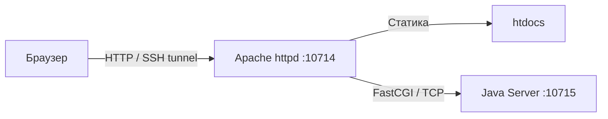
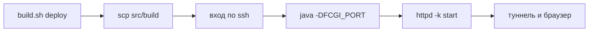

# Лабораторная работа №2 или муки деплоя FastCGI на Helios

В этой работе веб-сервер делится на две части: Apache httpd обслуживает статику, а Java FastCGI-сервер обрабатывает AJAX-запросы `fetch`.

Ниже приведён гайд по тому, как выполнить деплой на Helios. Чтобы `ssh` и `scp` не спрашивали пароль, один раз настройте ключ по заметке [helios.md](../../helios.md).

> [!note]
> Порт в документации с LMS везде -- 24000 / 24001. Поскольку этот порт с высокой долей вероятности будет занят, придумайте свой от 1024 до 65535. Данная работа сделана через порт 10714 / 10715.

> [!important]
> В командах ниже везде используется мой ИСУ: 365809. Для выполнения своей лабораторной работы не забудьте заменить его на свой.

## Архитектура решения

- Apache httpd слушает HTTP-порт и отдаёт HTML, JavaScript и пр.
- Динамические запросы к `/fcgi-bin/lab2-server.jar` перенаправляются модулем `mod_fastcgi` на отдельный TCP-порт FastCGI-сервера.
- FastCGI-сервер -- консольное приложение на Java, принимающее запросы через библиотеку `fastcgi-lib.jar`.



## Структура файлов в репозитории

```text
3_Web/lab2/
├── README.md             # Руководство по сборке и деплою
├── LMS.md                # Текст задания из системы
├── src/
│   ├── httpd.conf        # Конфигурация личного Apache
│   ├── build.sh          # Скрипт автоматизации сборки и развёртывания
│   ├── index.html        # Страница лабораторной работы
│   ├── js/               # Клиентские модули
│   ├── redirect/         # Заготовка index.html для se.ifmo.ru
│   ├── server/           # Java-исходники FastCGI-сервера и библиотека
│   └── build/            # Готовая раскладка для Helios (в git не попадает)
```

## Структура каталогов на Helios

Раскладка `src/build/` повторяет структуру `~/httpd-root/`:

```text
~
├── public_html/                          # Публичный каталог (системный Apache кафедры)
│   └── web/
│       ├── lab1/                         # Файлы первой лабораторной работы
│       └── lab2/
│           └── index.html                # Страница-редирект на личный Apache (опционально)
│
└── httpd-root/                           # Корень личного Apache и FastCGI бэкенда
    ├── conf/
    │   └── httpd.conf                    # Скопированный конфиг Apache
    ├── htdocs/                           # Статика: index.html, js/ и common/
    ├── fcgi-bin/
    │   └── lab2-server.jar               # Исполняемый файл FastCGI-сервера
    ├── mutex-dir/                        # Служебный каталог для мьютексов Apache
    ├── error.log                         # Логи ошибок Apache
    ├── access.log                        # Логи запросов Apache
    └── fcgi.log                          # Вывод и логи Java-процесса
```

## Сборка

Из корня репозитория (`ITMO`), нужен JDK 17 или новее:

```bash
bash 3_Web/lab2/src/build.sh          # раскладка для Helios (то же, что deploy)
bash 3_Web/lab2/src/build.sh clean    # удалить сгенерированное
```

Режим всего один: `deploy` раскладывает всё сразу в `src/build/`, поэтому отдельная сборка jar не нужна:
- `src/index.html`, `src/js/` и `3_Web/common/` копируются в `src/build/htdocs/`
- `httpd.conf` -- в `src/build/conf/`
- FastCGI-сервер компилируется сразу в `src/build/fcgi-bin/lab2-server.jar`

В итоге раскладка выглядит так:

```text
src/build/
├── conf/
│   └── httpd.conf
├── fcgi-bin/
│   └── lab2-server.jar
└── htdocs/
    ├── index.html
    ├── js/
    └── common/
        ├── css/
        └── assets/       # шрифты, картинки, favicon
```

Исходники в `src/` при сборке не меняются: всё производное лежит в `src/build/`

При сборке через WSL Bash установите JDK внутрь Ubuntu один раз:
```bash
sudo apt update && sudo apt install -y openjdk-17-jdk
```

Компиляция идёт с `--release 17`, потому что на Helios установлен OpenJDK 17. Каталог `src/build/` -- единственное место с производными файлами: после сборки в нём остаётся только готовая для копирования раскладка

На Windows запущенный FastCGI-процесс блокирует jar-файл, поэтому перед повторной сборкой его нужно остановить

## Остановка

Если серверы уже запущены на Helios (например, перед обновлением конфигурации или кода), остановите их внутри SSH-сессии:

```bash
httpd -f ~/httpd-root/conf/httpd.conf -k stop
pkill -f lab2-server.jar
```

## Запуск

> [!note]
> Для Apache выбран порт `10714`, а для Java FastCGI -- `10715`. Напрямую из внешнего интернета порты Helios закрыты брандмауэром университета, поэтому браузер подключается через SSH-туннель на `localhost:10714`.



### Локально (из корня репозитория `ITMO`)

1. Соберите раскладку:
   ```bash
   bash 3_Web/lab2/src/build.sh deploy
   ```

2. Залейте содержимое `src/build/` в `~/httpd-root/`:
   ```bash
   scp -P 2222 -r 3_Web/lab2/src/build/. s365809@helios.cs.ifmo.ru:httpd-root/
   ```
   > [!warning]
   > Каталог `~/httpd-root` должен уже существовать. При самом первом запуске создайте его на сервере командой `mkdir -p ~/httpd-root/mutex-dir`, затем вернитесь к заливке

### Helios

3. Подключитесь по SSH:

   ```bash
   ssh -p 2222 s365809@helios.cs.ifmo.ru
   ```

4. Выполните запуск процессов в открытой сессии:

   ```bash
   mkdir -p ~/httpd-root/mutex-dir   # только при первом запуске
   nohup java -DFCGI_PORT=10715 -jar ~/httpd-root/fcgi-bin/lab2-server.jar \
     > ~/httpd-root/fcgi.log 2>&1 &
   sockstat -4l | grep 10715         # проверка, что порт слушается
   httpd -f ~/httpd-root/conf/httpd.conf -t
   httpd -f ~/httpd-root/conf/httpd.conf -k start
   ```

   Если `httpd: command not found`, используйте полный путь `/usr/local/sbin/httpd`

5. Откройте SSH-туннель на локальном компьютере:
   ```bash
   ssh -p 2222 -L 10714:localhost:10714 s365809@helios.cs.ifmo.ru
   ```

6. Откройте страницу в браузере: `http://localhost:10714/`

## Проверка работы

После открытия страницы через SSH-туннель проверьте:
- статика: `http://localhost:10714/` отображает HTML-страницу со стилями и графиком
- динамика: прямой запрос `http://localhost:10714/fcgi-bin/lab2-server.jar?x=-2&y=2&r=5` возвращает корректный JSON-ответ

## Редирект

Страницу лабораторной работы можно открывать и через `se.ifmo.ru`, положив в публичный каталог `index.html` с переходом на сервер. Готовая заготовка лежит в `src/redirect/index.html`; это не часть задания, и в сборку она не входит.

## Локальный просмотр

Стили и шрифты лежат в `common/`, поэтому открывать `src/index.html` напрямую из файловой системы бесполезно. Сначала соберите раскладку, затем поднимите статический сервер:

```bash
bash 3_Web/lab2/src/build.sh deploy
npx serve 3_Web/lab2/src/build/htdocs
```

Так проверяются вёрстка, график и уведомления, но не запрос к FastCGI: без бэкенда кнопка «Проверить» вернёт ошибку. Полный сценарий проверяется через SSH-туннель.
