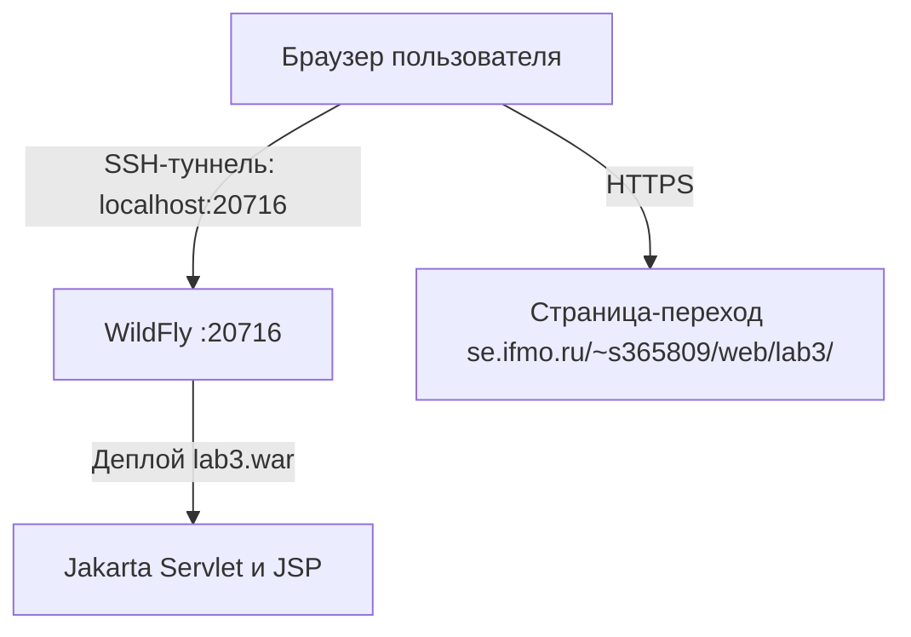
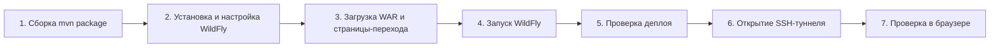

# Развёртывание Servlet и JSP на WildFly в Helios

Руководство по сборке, установке и запуску лабораторной работы №3 на сервере Helios кафедры ВТ.

В этой лабораторной приложение на Jakarta Servlet и JSP разворачивается в WildFly: сервер слушает HTTP, обслуживает сервлеты и компилирует JSP. Опционально публикуется статическая страница-переход: она не требуется по заданию и добавлена по собственной инициативе для удобного входа с `se.ifmo.ru`.

> [!note]
> Ограничение портов на Helios (политика mac_portacl: обычным пользователям запрещены порты ниже 16384) описано в руководстве [ЛР2](../lab2/DEPLOY.md). Здесь WildFly настроен на порты 20716 (HTTP), 20717 (HTTPS), 20718 и 20719 (management). Снаружи кастомные порты закрыты файрволом, доступ открывается через SSH-туннель.

> [!important]
> В командах используется SSH-алиас `helios` вместо полной строки `s365809@helios.cs.ifmo.ru`: он задан в `~/.ssh/config`. Как повторить -- в [helios.md](../../helios.md); без алиаса подставьте в команды полную строку со своим логином (для `scp` -- с флагом `-P 2222`). Логин `s365809` также фигурирует в адресе публичной страницы `se.ifmo.ru/~s365809/web/lab3/` и в тексте команды туннеля на странице-переходе `src/redirect/index.html` -- при использовании другим студентом замените и там.

## Архитектура развёртывания



## Структура каталогов на сервере Helios

Структура домашней директории пользователя на Helios:

```text
~
├── public_html/
│   └── web/
│       ├── common/                       # Общие ресурсы (стили, шрифты, иконки, JS-модули)
│       │   ├── assets/
│       │   ├── css/
│       │   └── js/
│       └── lab3/
│           └── index.html                # Страница-переход
│
└── wildfly/                              # Сервер приложений WildFly 42.0.0.Final
    ├── bin/
    │   ├── standalone.sh                 # Скрипт запуска сервера
    │   ├── jboss-cli.sh                  # Management CLI, используется для остановки
    │   └── standalone.conf               # Память JVM и порты
    ├── modules/                          # Серверные модули: Servlet API 6.1, Pages 4.0, JSTL 3.0.2
    └── standalone/
        ├── configuration/
        │   └── standalone.xml            # Listener'ы и порты по умолчанию (8080, 8443, 9990, 9993)
        ├── deployments/
        │   ├── lab3.war                  # Приложение
        │   └── lab3.war.deployed         # Маркер успешного деплоя
        └── log/
            └── server.log                # Лог сервера
```

Общие ресурсы включаются в WAR автоматически при сборке через `webResources` в `pom.xml`, поэтому для приложения отдельно копировать `3_Web/common/` не нужно.

Страница-переход обращается к ним по относительному пути `../common/`, поэтому `public_html/web/common/` должен быть загружен один раз: если вы делали ЛР2, он уже на месте.

## Сборка локально

Сборка запускается из корня репозитория (`ITMO`), требуются JDK 21 и Maven 3.8.4 или новее:

```bash
cd 3_Web/lab3
mvn clean package
```

Maven создаёт `target/lab3.war`. В POM Jakarta Servlet API объявлен со scope `provided`: классы API скачиваются из Maven Central только на время компиляции и не попадают в WAR, на сервере их предоставляет WildFly из своих модулей.

> [!note]
> Приложение компилируется с `--release 21` (`maven.compiler.release=21`). На текущем Helios системная команда `java` запускает OpenJDK 21.0.4.

## Установка WildFly на Helios

Пропустите раздел, если WildFly 42 уже установлен. Команды выполняются в SSH-сессии:

```bash
cd ~
curl -L -o wildfly.zip https://github.com/wildfly/wildfly/releases/download/42.0.0.Final/wildfly-42.0.0.Final.zip
unzip -q wildfly.zip
mv wildfly-42.0.0.Final wildfly
rm wildfly.zip
```

- Флаги: `-L` у `curl` переходит по редиректам (GitHub отдаёт файл с промежуточного адреса), `-o` сохраняет ответ в файл вместо вывода в терминал
- `-q` у `unzip` -- `quiet`, т.е. подавление вывода списка из тысяч распакованных файлов

Затем настройте `~/wildfly/bin/standalone.conf`, этот файл читает `standalone.sh` при запуске. В блоке `JBOSS_JAVA_SIZING` оставьте ограничение памяти:

```bash
JBOSS_JAVA_SIZING="-Xmx256m"
```

В конец файла добавьте одну строку `JAVA_OPTS` с портами; если такая строка уже есть, замените её, не добавляйте дубликат:

```bash
JAVA_OPTS="$JAVA_OPTS -Djboss.http.port=20716 -Djboss.https.port=20717 -Djboss.management.http.port=20718 -Djboss.management.https.port=20719"
```

> [!warning]
> Параметр `-Xmx256m` необходим, чтобы JVM не пыталась зарезервировать память исходя из всего объёма сервера (что приводит к ошибке `Could not reserve enough space for object heap`). Упавшая JVM оставляет в текущем каталоге отчёты `hs_err_pid*.log` и `replay_pid*.log`, а ядро -- дамп памяти `java.core`; если такие файлы появились, значит какой-то java-процесс был запущен без ограничения памяти, читайте самый свежий `hs_err`. Порты по умолчанию из `standalone.xml` (8080, 8443, 9990, 9993) запрещены mac_portacl, поэтому переопределяются Java-свойствами. WildFly не подбирает свободный порт автоматически: если указанный порт занят другим процессом, сервер не запустится.

## Остановка запущенного сервера

Deployment scanner подхватывает новый WAR и на работающем сервере, поэтому только ради обновления приложения останавливать WildFly не нужно. Остановка имеет смысл при изменении `standalone.conf` или `standalone.xml`.

Штатный способ -- management CLI: он подключается к management-порту `20718` и корректно завершает работу сервера:
```bash
JAVA_OPTS="-Xmx256m" ~/wildfly/bin/jboss-cli.sh --connect controller=127.0.0.1:20718 --command=":shutdown"
```
> Префикс `JAVA_OPTS` нужен по той же причине, что и самому серверу: без ограничения heap JVM CLI на Helios не стартует:

Запасной способ -- отправить сигнал процессу напрямую. Он грубее: управление обрывается без аккуратного завершения, а шаблон затрагивает все java-процессы WildFly:
```bash
pkill -f jboss-modules.jar
```

## Пошаговое развёртывание



### 1. Подготовка и загрузка файлов с локальной машины

Команды выполняются из корня репозитория:

1. Соберите WAR:
   ```bash
   cd 3_Web/lab3
   mvn clean package
   ```

2. Создайте целевые каталоги на Helios:
   ```bash
   ssh helios 'mkdir -p ~/public_html/web/common ~/public_html/web/lab3'
   ```

   > [!warning]
   > Утилита `scp` не создаёт родительские каталоги автоматически при копировании содержимого папок. Обязательно выполните создание папок перед копированием.

3. Скопируйте общие ресурсы в публичный каталог:
   ```bash
   scp -r 3_Web/common/. helios:public_html/web/common/
   ```

   > [!note]
   > Common нужен странице-переходу: она берёт из него стили и шрифты по пути `../common/`. Если правок в `3_Web/common/` с прошлой загрузки не было, шаг можно пропустить. Самому приложению он отдельно не нужен: при сборке WAR common включается в него автоматически

4. Скопируйте WAR в каталог деплоев:
   ```bash
   scp 3_Web/lab3/target/lab3.war helios:wildfly/standalone/deployments/lab3.war
   ```

   Если сервер в этот момент запущен, deployment scanner заметит новый WAR и развернёт его автоматически: появится маркер `lab3.war.deployed` при успехе или `lab3.war.failed` при ошибке.

5. Скопируйте страницу-переход в публичный каталог лабораторной:
   ```bash
   scp 3_Web/lab3/src/redirect/index.html helios:public_html/web/lab3/index.html
   ```

   > [!note]
   > Страница-переход не требуется по заданию ЛР3: это добровольное дополнение для удобного входа с `se.ifmo.ru`, шаг можно пропустить.

### 2. Запуск WildFly на Helios

Подключитесь к серверу по SSH:

```bash
ssh helios
```

Внутри SSH-сессии выполните следующие действия:

1. Запустите сервер:
   ```bash
   mkdir -p ~/wildfly/standalone/log
   nohup ~/wildfly/bin/standalone.sh > ~/wildfly/standalone/log/server.log 2>&1 &
   ```

   `nohup` и `&` уводят процесс в фон и позволяют ему пережить закрытие SSH-сессии. От перезагрузки сервера или системной очистки процессов `nohup` не спасает: если WildFly остановлен, повторите этот шаг.

2. Дождитесь старта и проверьте лог:
   ```bash
   sleep 20 && tail ~/wildfly/standalone/log/server.log
   ```

   В логе должна появиться строка вида `WFLYSRV0025: WildFly ... started`, а в каталоге `standalone/deployments/` -- маркер `lab3.war.deployed`.

3. Проверьте, что приложение отвечает внутри Helios:
   ```bash
   curl -s -o /dev/null -w "%{http_code}\n" http://127.0.0.1:20716/lab3/
   ```

   Ожидается код `200`.

### 3. Подключение и проверка

1. На локальном компьютере откройте SSH-туннель:
   ```bash
   ssh -L 20716:localhost:20716 helios
   ```

   > Если порт `20716` занят на вашем ноутбуке другим процессом, можете поменять только левый порт, например `ssh -L 8081:localhost:20716 helios`, и открыть тогда `http://localhost:8081/lab3/`.

2. Откройте в браузере страницу приложения: http://localhost:20716/lab3/

3. Проверьте контрольные сценарии:
   - отображение страницы: интерфейс загружается со стилями, шрифтами и графиком
   - отправка формы: клик по кнопке «Проверить» показывает страницу результата с вердиктом и добавляет строку в таблицу истории
   - клик по графику: точка отправляется AJAX-запросом, таблица и график обновляются без перезагрузки страницы
   - история результатов хранится в HTTP-сессии и сохраняется при возврате на форму

4. Проверьте страницу-переход по адресу https://se.ifmo.ru/~s365809/web/lab3/ : на ней показана команда туннеля и ссылка на приложение.
