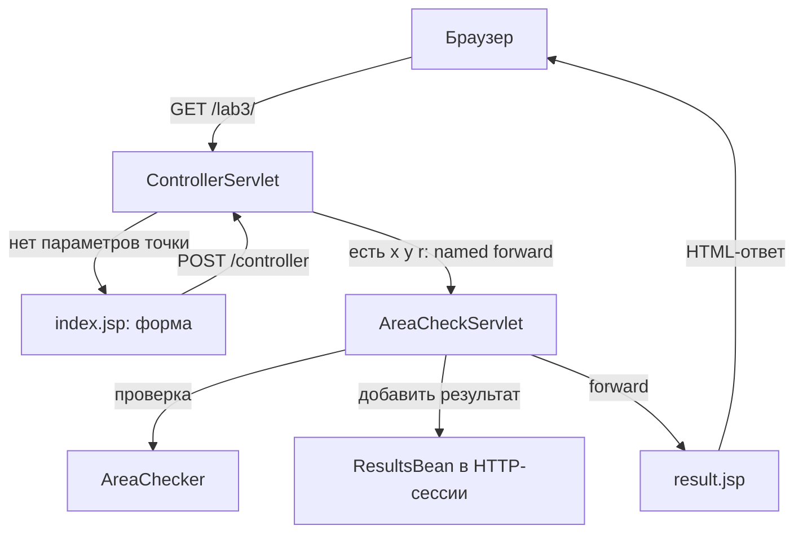

# Лабораторная работа №3 | Веб-программирование

- Студент: Пугин Сергей Евгеньевич
- Группа: P3219
- Вариант: 8679
- Публичная страница-переход: https://se.ifmo.ru/~s365809/web/lab3/

## О проекте

Веб-приложение на Jakarta Servlet и JSP проверяет попадание точки в область. `ControllerServlet` принимает запросы, `AreaCheckServlet` валидирует параметры и выполняет проверку на попадание, а `ResultsBean` хранит историю в HTTP-сессии. Форма, график и таблица результатов отображаются в JSP.

Общие стили, шрифты, валидация, отрисовка графика и всплывающие уведомления находятся в `3_Web/common/`. Maven включает эти файлы в WAR при сборке.

Порт `20716` закрыт снаружи, поэтому приложение доступно по адресу `http://localhost:20716/lab3/` после команды `ssh -p 2222 -L 20716:localhost:20716 s365809@helios.cs.ifmo.ru`. Для ЛР3 выбран отдельный HTTP-порт `20716`; Apache и FastCGI из ЛР2 переведены на порты `24014` и `24015` из-за ограничения mac_portacl на Helios (запрет портов ниже 16384).

## Поток приложения

Форма отправляет данные методом POST только в `ControllerServlet`. `AreaCheckServlet` не вызывается из браузера напрямую: контроллер передаёт ему запрос внутренним `RequestDispatcher`, а результат возвращается как JSP-страница.

Приложение использует два независимых потока:
- отправка формы -- обычный POST без `preventDefault`, браузер переходит на `/lab3/controller` и получает отдельную страницу `result.jsp` с параметрами, вердиктом, историей и ссылкой возврата
- клик по графику -- AJAX-запрос из `main.js`; ответ разбирается на месте, таблица истории и график обновляются без перезагрузки страницы


После возврата со страницы результата форма восстанавливает последние значения `X`, `Y` и `R` из `ResultsBean`, а история сохраняется в сессии.

## Сборка

Нужны JDK 21 и Maven 3.8.4 или новее. Приложение использует Jakarta Servlet 6.1 и рассчитано на WildFly 42.0.0.Final с Jakarta EE 11 web-профилем. Jakarta Servlet API предоставляется сервером, а версии Maven-плагинов зафиксированы для компиляции под Java 21 и упаковки WAR с общими ресурсами. Ограничение памяти Maven задано в `.mvn/jvm.config`, переменные окружения не требуются. Из корня репозитория:

```bash
cd 3_Web/lab3
mvn clean package
```

Результат: `target/lab3.war`. Серверные зависимости Jakarta EE предоставляет WildFly.

## Структура

```text
lab3/
├── README.md
├── DEPLOY.md
├── LMS.md
├── pom.xml
├── .mvn/jvm.config
└── src/
    ├── main/
    │   ├── java/app/
    │   │   ├── ControllerServlet.java
    │   │   ├── model/
    │   │   └── service/AreaChecker.java
    │   └── webapp/
    │       ├── WEB-INF/
    │       │   ├── web.xml
    │       │   └── views/
    │       │       ├── index.jsp
    │       │       ├── result.jsp
    │       │       ├── workspace.jspf
    │       │       └── components/
    │       │           ├── head.jspf
    │       │           ├── header.jspf
    │       │           ├── history-rows.jspf
    │       │           ├── toasts.jspf
    │       │           └── page-end.jspf
    │       ├── css/lab3.css
    │       └── js/
    │           ├── main.js
    │           └── shape.js
    └── redirect/index.html
```

Развёртывание страницы-перехода не требует отдельной сборки: URL приложения уже указан в `src/redirect/index.html`, поэтому файл можно сразу копировать на `se.ifmo.ru`:
```bash
scp -P 2222 -r 3_Web/common/. s365809@helios.cs.ifmo.ru:public_html/web/common/
scp -P 2222 3_Web/lab3/src/redirect/index.html s365809@helios.cs.ifmo.ru:public_html/web/lab3/index.html
```

Сборка WAR также добавляет `common/` из `3_Web/common/`; каталог `target/` создаётся Maven и в исходную структуру не входит.
